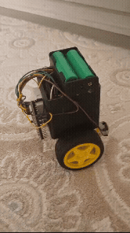
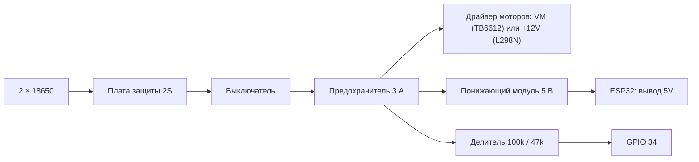
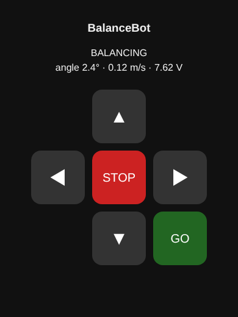

# Балансирующий робот на ESP32

<p align="center">
  
</p>

Двухколёсный робот, который держит равновесие сам (обратный маятник) и управляется с телефона.
ESP32 читает наклон с датчика MPU-6050, ПИД-регулятор крутит колёса так, чтобы они всегда
оказывались под корпусом.

Проект основан на [ugurakar0/esp32-self-balancing-robot](https://github.com/ugurakar0/esp32-self-balancing-robot)
(лицензия MIT). Эта версия исправляет найденные в нём ошибки, добавляет защиту и делает робота
удобным для занятий в классе. Что именно изменилось — в разделе [«Что исправлено»](#что-исправлено).

---

## Содержание

- [Детали](#детали)
- [Подключение](#подключение)
- [Прошивка](#прошивка)
- [Первый запуск по шагам](#первый-запуск-по-шагам)
- [Управление с телефона](#управление-с-телефона)
- [Команды в мониторе порта](#команды-в-мониторе-порта)
- [Энкодеры колёс (необязательно)](#энкодеры-колёс-необязательно)
- [Если что-то не так](#если-что-то-не-так)
- [Как устроена прошивка](#как-устроена-прошивка)
- [Что исправлено](#что-исправлено)

---

## Детали

| Кол-во | Деталь | Зачем |
|:---:|:---|:---|
| 1 | ESP32 DevKit C (ESP32-WROOM-32) | Мозг робота |
| 2 | Мотор TT с редуктором и колесо 65 мм | Привод |
| 1 | Драйвер моторов **TB6612FNG** (рекомендуется) или L298N | L298N теряет около 2 В и греется; TB6612FNG почти без потерь |
| 1 | MPU-6050 (модуль GY-521) | Датчик наклона |
| 2 | Аккумулятор 18650 и держатель 2S | Питание 7,4 В |
| 1 | Плата защиты 2S (BMS) | Не даёт переразрядить и закоротить аккумуляторы |
| 1 | Понижающий модуль на 5 В (MP1584 или LM2596) | Отдельное питание ESP32, см. ниже |
| 1 | Выключатель и предохранитель на 3 А | Безопасность |
| 1 | Корпус 8×8×8 см и 2 держателя моторов | Держатель: `hardware/stl/tt_motor_holder.stl`. Файл корпуса автор оригинала потерял: подойдёт любая коробка, датчик ставится на крышку |
| — | Резисторы 100 кОм и 47 кОм | По желанию: контроль заряда батареи |
| — | Моторы TT с энкодерами | По желанию: робот стоит на месте и не уезжает |

## Подключение

| Модуль | Вывод | ESP32 |
|:---|:---|:---:|
| Драйвер (L298N / TB6612FNG) | ENA / PWMA | GPIO 14 |
| | IN1 / AIN1 | GPIO 27 |
| | IN2 / AIN2 | GPIO 26 |
| | ENB / PWMB | **GPIO 13** (в оригинале было 12, см. ниже) |
| | IN3 / BIN1 | GPIO 25 |
| | IN4 / BIN2 | GPIO 33 |
| | STBY (только TB6612FNG) | 3,3 В (или свободный GPIO, `PIN_MOTOR_STBY` в `config.h`) |
| MPU-6050 | SDA / SCL | GPIO 21 / GPIO 22 |
| | VCC / GND | 3,3 В / GND |
| Делитель батареи (по желанию) | средняя точка | GPIO 34 |
| Энкодер левого колеса (по желанию) | A / B | GPIO 18 / GPIO 19 |
| Энкодер правого колеса (по желанию) | A / B | GPIO 23 / GPIO 32 |

Все выводы меняются в одном файле — `firmware/self_balancing_robot/config.h`. На платах ESP32-S3 и
ESP32-C3 часть этих номеров не существует, выберите другие.

**Почему GPIO 13, а не 12.** GPIO 12 влияет на загрузку ESP32: если в момент включения на нём
окажется высокий уровень (например, на L298N осталась перемычка ENB), плата не запустится.

### Питание



- **Все минусы соединены** (аккумулятор, драйвер, ESP32, датчик).
- **ESP32 питается от отдельного понижающего модуля**, а не от стабилизатора на плате L298N, как в
  оригинале. Когда моторы резко тянут ток, батарея проседает, и стабилизатор L298N перестаёт
  выдавать 5 В — ESP32 перезагружается прямо во время балансировки.
- У TB6612FNG вывод VCC (логика) подключается к 3,3 В ESP32, VM — к батарее.
- Делитель батареи: «+» батареи → 100 кОм → GPIO 34 → 47 кОм → GND. После сборки включите
  `BATTERY_MONITOR_ENABLED` в `config.h`. Робот будет добавлять мощность по мере разряда и
  остановится при 6,4 В, чтобы не испортить аккумуляторы.

Схема оригинальной сборки (с L298N и GPIO 12): [docs/images/espcircuit.svg](docs/images/espcircuit.svg).

## Прошивка

1. Установите Arduino IDE 2 и в **Boards Manager** пакет **esp32** от Espressif (сборка проверена на
   версиях 3.3.12 и 2.0.17). Плата: **ESP32 Dev Module**.
2. Откройте `firmware/self_balancing_robot/self_balancing_robot.ino`. Остальные файлы папки
   откроются вкладками.
3. Дополнительные библиотеки **не нужны**: датчик читается напрямую, всё остальное входит в пакет ESP32.
4. В `config.h` выберите способ управления с телефона — `REMOTE_MODE` (см. ниже) — и при
   необходимости поправьте выводы.
5. Загрузите прошивку и откройте монитор порта на **115200** бод.

## Первый запуск по шагам

Делайте шаги по порядку: каждый проверяет одну вещь, и ошибка не перейдёт в следующий.

1. **Калибровка гироскопа.** Первую секунду после включения робот должен лежать неподвижно. В
   мониторе появится `Gyro calibrated`. Если робота сдвинули, калибровка повторится сама.
   Повторить вручную: `stop`, затем `calib`.
2. **Направление датчика.** Введите `log 2` и откройте **Tools → Serial Plotter**. Медленно
   наклоняйте робота в одну сторону. Пока он движется, линия `rate` должна быть **с тем же
   знаком**, в котором меняется `angle`. Если знаки разные — в `config.h` в функции
   `pitchRateFromGyro` поставьте минус: `return -gy;`. Сторона, в которую `angle` растёт,
   дальше называется **«вперёд»**.
3. **Направление моторов.** Введите `stop`, поднимите робота так, чтобы колёса висели в воздухе,
   и введите `motortest`. Сначала крутится левое колесо, потом правое — каждое должно катить
   робота **вперёд**. Если колесо крутится назад, поменяйте его флаг `LEFT_MOTOR_REVERSED` или
   `RIGHT_MOTOR_REVERSED` в `config.h`.
4. **Точка равновесия.** После `stop` держите робота в положении, где он почти не падает ни в
   одну сторону, и введите `zero`, затем `save`.
5. **Подбор коэффициентов.** Введите `go` и держите робота вертикально — через полсекунды
   моторы включатся (в мониторе `State: BALANCING`).
   - Поставьте `ki 0` и `kd 0`. Увеличивайте `kp` шагами (3, 6, 9, 12, 15, 18), пока робот не
     начнёт держаться, раскачиваясь.
   - Добавляйте `kd` (обычно 0,1–0,9), пока раскачка не исчезнет.
   - Добавьте немного `ki` (0–0,5), если робот стоит с постоянным креном.
   - Смотрите графики в Serial Plotter (`log 2`): так видно, что меняет каждый коэффициент.
   - Готово — `save`.
6. **Телефон** — следующий раздел.

Моторы включаются только если робот подержали вертикально полсекунды: после включения, после
падения и после `stop` / `go`. Лежащий робот не рванёт с места.

## Управление с телефона

Каждый робот называется **BalanceBot-XXXX**, где XXXX — последние цифры адреса его платы. Имя
печатается в мониторе при включении, поэтому в классе роботы не путаются.

**Bluetooth** (`REMOTE_MODE REMOTE_BLUETOOTH`, по умолчанию): подключитесь к роботу из приложения
с кнопками, например *Arduino Bluetooth Controller* в режиме пульта. Работает только с Android и
только на обычной ESP32. В версии 4.0 пакета ESP32 этот вид Bluetooth по умолчанию
будет отключён.

**Wi-Fi** (`REMOTE_MODE REMOTE_WIFI`): робот создаёт свою сеть BalanceBot-XXXX (пароль
`robot1234`, меняется в `config.h`). Подключите телефон к ней и откройте `http://192.168.4.1`.
Приложение не нужно, работает на iPhone и на любой ESP32.

<p align="center">
  
</p>

| Кнопка / буква | Действие |
|:---:|:---|
| W / ▲ | Вперёд (пока кнопка нажата) |
| S / ▼ | Назад |
| A / ◀ | Влево |
| D / ▶ | Вправо |
| L | Перестать ехать (приложение шлёт при отпускании кнопки) |
| X / STOP | Аварийная остановка: моторы выключены до команды G |
| G / GO | Разрешить балансировку снова |

Если команды перестают приходить дольше `timeout` (600 мс), робот перестаёт ехать и просто стоит.

## Команды в мониторе порта

Команда вводится строкой и Enter: `kp 15`, `kp=15` или как в оригинале `p15`. Ввод команды
больше не останавливает робота.

| Команда | Что делает |
|:---|:---|
| `kp`, `ki`, `kd` (`p`, `i`, `d`) | Коэффициенты ПИД |
| `base` (`t`) | Угол, при котором робот вертикален |
| `lean` (`m`) | Наклон при езде, градусы (без энкодеров) |
| `turn` (`n`) | Сила поворота |
| `ramp` (`r`), `turnramp` (`u`) | Плавность разгона и поворота, секунды |
| `timeout` (`x`) | Через сколько мс без команд с телефона остановиться |
| `vkp`, `vki`, `vmax` | Регулятор скорости (только с энкодерами) |
| `autotrim 1` / `0` (`a1` / `a0`) | Авто-подстройка точки равновесия (без энкодеров) |
| `show` или `?` | Все параметры с допустимыми диапазонами |
| `save` | Запомнить значения после перезагрузки |
| `defaults` | Вернуть заводские значения |
| `stop` / `go` | Аварийная остановка / разрешить балансировку |
| `zero` | Текущий угол сделать точкой равновесия (после `stop`) |
| `calib` | Заново откалибровать гироскоп (после `stop`, робот неподвижен) |
| `motortest` | Покрутить левое, затем правое колесо вперёд (после `stop`) |
| `encoders` | Счётчики энкодеров с прошлого вызова |
| `log 0` / `1` / `2` | Вывод: выключен / текстом / для Serial Plotter |
| `help` | Список команд |

Значение вне допустимого диапазона не принимается как есть: оно ограничивается, и монитор об этом
сообщает.

## Энкодеры колёс (необязательно)

Без энкодеров робот держит только угол: он медленно уезжает и не может стоять на одном месте.
С энкодерами работает второй регулятор — по скорости. Он сам выбирает нужный наклон, держит
робота на месте, а телефон задаёт скорость (`vmax`, м/с).

1. Возьмите моторы TT с энкодерами, подключите A и B (см. таблицу), включите
   `ENCODERS_ENABLED` в `config.h`.
2. Впишите `ENCODER_COUNTS_PER_WHEEL_REV`. Узнать его можно так: введите `encoders`, прокатите
   робота ровно на один оборот колеса вперёд и снова введите `encoders` — это и есть нужное число.
3. При прокатывании вперёд оба числа должны быть положительными. Если одно отрицательное,
   поменяйте его флаг `LEFT_ENCODER_REVERSED` или `RIGHT_ENCODER_REVERSED`.
4. Начните с `vkp 3`, `vki 1`. Если робот медленно раскачивается вперёд-назад, уменьшите `vki`.

## Если что-то не так

| Признак | Что проверить |
|:---|:---|
| `IMU not found` / `IMU stopped answering` | Провода SDA, SCL, питание датчика. Робот сам переподключится, когда датчик ответит |
| Робот рвётся в сторону наклона и падает быстрее, чем без моторов | Направление моторов (шаг 3) или знак `rate` (шаг 2) |
| Мелко дрожит на месте | Слишком большой `kd` или `kp`; проверьте `MOTOR_PWM_MIN` для своих моторов |
| Медленно раскачивается с большой амплитудой | Слишком большой `ki` |
| Стоит, но всё время уезжает в одну сторону | `zero` в точке равновесия, `autotrim 1`, а лучше энкодеры |
| Плата перезагружается при резком движении | Питание ESP32 от отдельного модуля 5 В (см. «Питание») |
| После включения ничего не происходит | Держите робота вертикально: моторы включаются через полсекунды. Проверьте, не нажат ли STOP (`go`) |
| Телефон не находит робота по Bluetooth | iPhone не поддерживает этот вид Bluetooth — включите `REMOTE_WIFI` |

## Как устроена прошивка

```
firmware/self_balancing_robot/
  self_balancing_robot.ino   цикл 200 Гц: датчик -> фильтр -> состояние -> ПИД -> моторы
  console.ino                команды из монитора порта
  config.h                   всё, что зависит от вашей сборки (выводы, направления, режимы)
  imu.*                      MPU-6050 через регистры, с проверкой ошибок шины
  control.h                  фильтр угла, калибровка гироскопа, плавные изменения
  balance.h                  ПИД, авто-подстройка, когда можно включать моторы, тест моторов, регулятор скорости
  drive_math.h, motors.*     скважность моторов (без скачка у нуля), драйвер L298N / TB6612
  battery.*                  напряжение батареи, поправка мощности, отсечка
  encoders.*                 счёт импульсов энкодеров
  remote.*, remote_page.h    Bluetooth или Wi-Fi-страница
  settings.h, settings_store.* , tuning.*, command.h   параметры, их сохранение и команды
tests/host/                  автотесты логики, запускаются на компьютере без платы
```

Автотесты: `tests/host/run.sh` (нужен g++). GitHub Actions запускает их и собирает прошивку
для ESP32 (Bluetooth и Wi-Fi) и ESP32-S3 при каждом изменении — `.github/workflows/ci.yml`.

## Что исправлено

| # | Было в оригинале | Стало |
|:---:|:---|:---|
| 1 | Каждая команда в мониторе порта (`p15`) останавливала программу до 1 с, и робот падал | Команды читаются без ожидания |
| 2 | Мощность моторов прыгала с 0 до 70 из 255 при любой команде, робот дрожал на месте | Плавный переход у нуля |
| 3 | Смещение гироскопа не учитывалось, робот медленно уезжал | Калибровка при включении и командой `calib` |
| 4 | Авто-подстройка с неверным знаком, без ограничений, работала и при езде | Правильный знак, предел ±2°, учится только когда робот стоит |
| 5 | Моторы включались сразу при наклоне меньше 30°: лежащий или поднятый робот рвался с места | Включение после удержания вертикально 0,5 с, аварийная остановка |
| 6 | Производная по ошибке: шум и рывок после перезапуска | Скорость наклона берётся прямо с гироскопа |
| 7 | Фильтр слишком доверял акселерометру и зависел от скорости цикла | Фильтр с постоянной времени 0,5 с |
| 8 | Цикл без постоянной частоты | Ровные 200 Гц, шина датчика 400 кГц |
| 9 | Нет контроля скорости | Энкодеры и регулятор скорости (по желанию) |
| 10 | Ошибки чтения датчика не замечались, без датчика плата зависала | Ошибки отслеживаются, моторы останавливаются, датчик переподключается |
| 11 | ESP32 питалась от стабилизатора L298N | Отдельный модуль 5 В (раздел «Питание») |
| 12 | L298N теряет около 2 В | Поддержка TB6612FNG |
| 13 | Не было контроля батареи | Делитель на GPIO 34: поправка мощности и отсечка 6,4 В |
| 14 | Мотор на GPIO 12 мешал загрузке | Перенесён на GPIO 13 |
| 15 | У всех роботов одно имя «DengeRobot» | BalanceBot-XXXX по адресу платы |
| 16 | Только Android | Wi-Fi-пульт в браузере для любого телефона |
| 17 | Настройки терялись после перезагрузки | `save` / `defaults` |
| 18 | Лог неудобно смотреть | `log 2` для Serial Plotter |
| 19 | README ссылался на несуществующий файл STL | Файл переименован, ссылки исправлены |
| 20 | Чужой `.gitignore`, версии библиотек не закреплены, нет проверок | Библиотеки не нужны, автотесты и сборка в CI |
| 21 | Весь код в одном файле, направления зашиты в код | Модули и `config.h` |

Код проверен сборкой и автотестами. На реальном роботе исправления ещё нужно проверить: начните
с шагов из раздела [«Первый запуск»](#первый-запуск-по-шагам).

## Лицензия

MIT, как у оригинала, — см. [LICENSE](LICENSE). Автор исходного проекта — ugurakar0.
